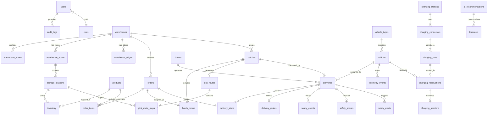

# DATABASE_SCHEMA.md

**Project:** AI-Driven Smart Logistics Platform for Warehouse Optimization, Delivery Safety, and EV Charging Management  
**Target Database:** PostgreSQL 15+  
**ORM:** SQLAlchemy 2.x  
**Migration Tool:** Alembic  
**Version:** 1.0  
**Baseline Specs:** `PROJECT_REQUIREMENTS.md`, `ARCHITECTURE.md`, `UI_UX_SPECIFICATION.md`, `AGENTS.md`, `MASTER_IMPLEMENTATION_PLAN.md`, `AGENT_RULES.md`

---

## 1. Database Design Goals

1. **Unified Operational Backbone:** Provide a single relational PostgreSQL schema that connects warehouse picking, delivery fleet safety, and EV charging operations.
2. **Deterministic Data Integrity:** Enforce strict foreign key constraints, check constraints, unique constraints, and enums to prevent invalid data states (e.g. negative quantities, battery SoC outside 0–100%, double-booked charging slots).
3. **Optimized for Real-Time & Analytical Access:** Support sub-second REST API lookups, fast spatial index queries, efficient telemetry event appending, and time-series query aggregations.
4. **AI Agent Access Isolation:** Ensure AI agents interact with the database exclusively through validated service APIs and repositories. No agent will generate or execute raw DDL/DML SQL statements.
5. **Traceability & Auditability:** Record model versions, input snapshots, explanations, confidence scores, and audit trail records for all automated and user actions.

---

## 2. Domain Boundaries

The database is divided into 9 logical domain schemas:

```text
┌───────────────────────────────────────────────────────────────────────────┐
│                          1. Identity & RBAC                               │
│                         (users, roles, audit_logs)                        │
└─────────────────────┬───────────────────────────────┬─────────────────────┘
                      │                               │
                      ▼                               ▼
┌─────────────────────────────────────────┐ ┌───────────────────────────────┐
│        2. Warehouse Operations          │ │   6. Fleet & Vehicle Register │
│ (warehouses, warehouse_zones, nodes,    │ │ (drivers, vehicle_types,      │
│  edges, storage_locations, products,    │ │  vehicles, ev_battery_specs)  │
│  inventory)                             │ └───────────────┬───────────────┘
└─────────────────────┬───────────────────┘                 │
                      │                                     │
                      ▼                                     │
┌─────────────────────────────────────────┐                 │
│          3. Customer Orders             │                 │
│        (orders, order_items)            │                 │
└─────────────────────┬───────────────────┘                 │
                      │                                     │
                      ▼                                     │
┌─────────────────────────────────────────┐                 │
│      4. Batching & Pick Operations      │                 │
│ (batches, batch_orders, pick_routes,    │                 │
│  pick_route_steps)                      │                 │
└─────────────────────┬───────────────────┘                 │
                      │                                     │
                      ▼                                     │
┌───────────────────────────────────────────────────────────┴───────────────┐
│                            5. Delivery Fleet                              │
│                (deliveries, delivery_stops, delivery_routes)             │
└─────────────────────┬───────────────────────────────┬─────────────────────┘
                      │                               │
                      ▼                               ▼
┌─────────────────────────────────────────┐ ┌───────────────────────────────┐
│         7. Telemetry & Safety           │ │       8. EV Charging          │
│ (telemetry_events, safety_events,       │ │ (charging_stations,           │
│  safety_scores, safety_alerts)          │ │  connectors, slots,          │
└─────────────────────────────────────────┘ │  reservations, sessions)      │
                                            └───────────────┬───────────────┘
                                                            │
┌───────────────────────────────────────────────────────────▼───────────────┐
│                       9. Shared Intelligence & System                     │
│                    (forecasts, ai_recommendations)                        │
└───────────────────────────────────────────────────────────────────────────┘
```

---

## 3. Entity List

| Domain | Entity Name | Table Name | Primary Role |
|---|---|---|---|
| Identity | User | `users` | User accounts and credentials |
| Identity | Role | `roles` | Role-based access definitions |
| Identity | AuditLog | `audit_logs` | System security and administrative audit trail |
| Warehouse | Warehouse | `warehouses` | Facility details and geographical locations |
| Warehouse | WarehouseZone | `warehouse_zones` | Functional zones (Aisle, Cold Storage, Dispatch) |
| Warehouse | WarehouseNode | `warehouse_nodes` | Graph vertices for indoor pathfinding |
| Warehouse | WarehouseEdge | `warehouse_edges` | Graph edges and distance metrics |
| Warehouse | StorageLocation | `storage_locations` | Specific shelf/bin locations inside nodes |
| Warehouse | Product | `products` | SKU catalog, dimensions, and weights |
| Warehouse | Inventory | `inventory` | Stock quantities per product and storage location |
| Orders | Order | `orders` | Customer fulfillment orders |
| Orders | OrderItem | `order_items` | SKU line items per customer order |
| Batch & Pick | Batch | `batches` | Grouped orders for picker efficiency |
| Batch & Pick | BatchOrder | `batch_orders` | Many-to-many link between batches and orders |
| Batch & Pick | PickRoute | `pick_routes` | Optimized indoor picking path for a batch |
| Batch & Pick | PickRouteStep | `pick_route_steps` | Ordered sequence of nodes/bins to visit |
| Delivery | Delivery | `deliveries` | Dispatch task for assigned batch, driver, and vehicle |
| Delivery | DeliveryStop | `delivery_stops` | Customer stop sequence for delivery routes |
| Delivery | DeliveryRoute | `delivery_routes` | Planned external road path & distance |
| Fleet | Driver | `drivers` | Delivery partner profile & license details |
| Fleet | VehicleType | `vehicle_types` | Vehicle classification (2-wheeler, Van, EV) |
| Fleet | Vehicle | `vehicles` | Fleet vehicle registry & live status |
| Telemetry | TelemetryEvent | `telemetry_events` | High-frequency GPS, speed, braking & SoC logs |
| Safety | SafetyEvent | `safety_events` | Violations (speeding, harsh braking, deviation) |
| Safety | SafetyScore | `safety_scores` | Calculated Safety Score per delivery ($100 - \text{penalties}$) |
| Safety | SafetyAlert | `safety_alerts` | Real-time alerts generated for fleet operators |
| EV Charging | ChargingStation | `charging_stations` | Station metadata & geographic location |
| EV Charging | ChargingConnector | `charging_connectors` | Physical plugs (CCS2, Type 2) & power output |
| EV Charging | ChargingSlot | `charging_slots` | Reservable time windows per connector |
| EV Charging | ChargingReservation | `charging_reservations` | Slot bookings reserved by EV drivers |
| EV Charging | ChargingSession | `charging_sessions` | Active and past energy transfer sessions |
| Intelligence | Forecast | `forecasts` | Time-series demand and queue predictions |
| Intelligence | AIRecommendation | `ai_recommendations` | Decision logs, explanations, and model versions |

---

## 4. Entity-Relationship Diagram



---

## 5. Detailed Table Specifications

### 5.1 Domain A: Identity & RBAC

#### 1. `roles`
Stores system user roles for Role-Based Access Control.
- `id` (INT, PK, AUTO-INCREMENT)
- `code` (VARCHAR(32), UNIQUE, NOT NULL) — e.g. `admin`, `warehouse_operator`, `driver`, `fleet_manager`, `station_admin`
- `description` (TEXT)
- `created_at` (TIMESTAMPTZ, DEFAULT NOW())

#### 2. `users`
System user accounts.
- `id` (BIGINT, PK, AUTO-INCREMENT)
- `role_id` (INT, FK -> `roles.id`, NOT NULL)
- `email` (VARCHAR(255), UNIQUE, NOT NULL)
- `password_hash` (VARCHAR(255), NOT NULL)
- `full_name` (VARCHAR(128), NOT NULL)
- `phone` (VARCHAR(32))
- `is_active` (BOOLEAN, DEFAULT TRUE, NOT NULL)
- `created_at` (TIMESTAMPTZ, DEFAULT NOW(), NOT NULL)
- `updated_at` (TIMESTAMPTZ, DEFAULT NOW(), NOT NULL)

#### 3. `audit_logs`
Tracks administrative and privileged actions.
- `id` (BIGINT, PK, AUTO-INCREMENT)
- `user_id` (BIGINT, FK -> `users.id`, NULLABLE)
- `action` (VARCHAR(64), NOT NULL) — e.g. `CREATE_BATCH`, `RESERVE_SLOT`
- `resource_type` (VARCHAR(64), NOT NULL) — e.g. `order`, `reservation`
- `resource_id` (VARCHAR(64))
- `details` (JSONB)
- `ip_address` (VARCHAR(45))
- `created_at` (TIMESTAMPTZ, DEFAULT NOW(), NOT NULL)

---

### 5.2 Domain B: Warehouse Structure & Products

#### 4. `warehouses`
Facility details.
- `id` (INT, PK, AUTO-INCREMENT)
- `code` (VARCHAR(32), UNIQUE, NOT NULL)
- `name` (VARCHAR(128), NOT NULL)
- `latitude` (DECIMAL(10, 8), NOT NULL)
- `longitude` (DECIMAL(11, 8), NOT NULL)
- `address` (TEXT)
- `status` (VARCHAR(32), DEFAULT 'active', NOT NULL) — Enum: `active`, `maintenance`, `inactive`
- `created_at` (TIMESTAMPTZ, DEFAULT NOW(), NOT NULL)
- `updated_at` (TIMESTAMPTZ, DEFAULT NOW(), NOT NULL)

#### 5. `warehouse_zones`
Functional zones inside a warehouse.
- `id` (INT, PK, AUTO-INCREMENT)
- `warehouse_id` (INT, FK -> `warehouses.id`, NOT NULL)
- `zone_code` (VARCHAR(32), NOT NULL) — e.g. `ZONE_A`, `COLD_STORAGE`
- `name` (VARCHAR(64), NOT NULL)
- `zone_type` (VARCHAR(32), DEFAULT 'standard', NOT NULL) — Enum: `standard`, `cold`, `hazmat`, `high_value`

#### 6. `warehouse_nodes`
Graph vertices for indoor navigation.
- `id` (BIGINT, PK, AUTO-INCREMENT)
- `warehouse_id` (INT, FK -> `warehouses.id`, NOT NULL)
- `zone_id` (INT, FK -> `warehouse_zones.id`, NULLABLE)
- `node_code` (VARCHAR(32), NOT NULL)
- `x_coord` (DECIMAL(8, 2), NOT NULL) — Metric X coordinate (meters)
- `y_coord` (DECIMAL(8, 2), NOT NULL) — Metric Y coordinate (meters)
- `z_coord` (DECIMAL(8, 2), DEFAULT 0.0, NOT NULL) — Shelf height level
- `is_blocked` (BOOLEAN, DEFAULT FALSE, NOT NULL)

#### 7. `warehouse_edges`
Walkable paths connecting nodes.
- `id` (BIGINT, PK, AUTO-INCREMENT)
- `warehouse_id` (INT, FK -> `warehouses.id`, NOT NULL)
- `from_node_id` (BIGINT, FK -> `warehouse_nodes.id`, NOT NULL)
- `to_node_id` (BIGINT, FK -> `warehouse_nodes.id`, NOT NULL)
- `distance_meters` (DECIMAL(8, 2), NOT NULL)
- `is_bidirectional` (BOOLEAN, DEFAULT TRUE, NOT NULL)
- `is_blocked` (BOOLEAN, DEFAULT FALSE, NOT NULL)

#### 8. `storage_locations`
Specific bin/shelf positions linked to nodes.
- `id` (BIGINT, PK, AUTO-INCREMENT)
- `node_id` (BIGINT, FK -> `warehouse_nodes.id`, NOT NULL)
- `location_code` (VARCHAR(32), UNIQUE, NOT NULL) — e.g. `A-04-S2`
- `aisle` (VARCHAR(16), NOT NULL)
- `shelf` (VARCHAR(16), NOT NULL)
- `bin` (VARCHAR(16), NOT NULL)
- `max_weight_kg` (DECIMAL(8, 2), DEFAULT 100.0, NOT NULL)

#### 9. `products`
Master SKU catalog.
- `id` (BIGINT, PK, AUTO-INCREMENT)
- `sku` (VARCHAR(64), UNIQUE, NOT NULL)
- `name` (VARCHAR(255), NOT NULL)
- `category` (VARCHAR(64), NOT NULL)
- `unit_weight_kg` (DECIMAL(8, 3), NOT NULL)
- `unit_volume_cbm` (DECIMAL(8, 4), NOT NULL)
- `price` (DECIMAL(10, 2), NOT NULL)
- `created_at` (TIMESTAMPTZ, DEFAULT NOW(), NOT NULL)

#### 10. `inventory`
Stock levels at storage locations.
- `id` (BIGINT, PK, AUTO-INCREMENT)
- `warehouse_id` (INT, FK -> `warehouses.id`, NOT NULL)
- `location_id` (BIGINT, FK -> `storage_locations.id`, NOT NULL)
- `product_id` (BIGINT, FK -> `products.id`, NOT NULL)
- `quantity` (INT, NOT NULL)
- `reorder_threshold` (INT, DEFAULT 10, NOT NULL)
- `updated_at` (TIMESTAMPTZ, DEFAULT NOW(), NOT NULL)

---

### 5.3 Domain C: Orders

#### 11. `orders`
Customer fulfillment orders.
- `id` (BIGINT, PK, AUTO-INCREMENT)
- `order_number` (VARCHAR(64), UNIQUE, NOT NULL)
- `warehouse_id` (INT, FK -> `warehouses.id`, NOT NULL)
- `customer_name` (VARCHAR(128))
- `destination_address` (TEXT, NOT NULL)
- `destination_lat` (DECIMAL(10, 8), NOT NULL)
- `destination_lon` (DECIMAL(11, 8), NOT NULL)
- `priority` (INT, DEFAULT 1, NOT NULL) — 1: Normal, 2: High, 3: Express
- `status` (VARCHAR(32), DEFAULT 'pending', NOT NULL) — Enum: `pending`, `batched`, `picking`, `picked`, `in_transit`, `delivered`, `cancelled`
- `created_at` (TIMESTAMPTZ, DEFAULT NOW(), NOT NULL)
- `promised_at` (TIMESTAMPTZ, NOT NULL)

#### 12. `order_items`
SKUs and quantities per order.
- `id` (BIGINT, PK, AUTO-INCREMENT)
- `order_id` (BIGINT, FK -> `orders.id`, NOT NULL)
- `product_id` (BIGINT, FK -> `products.id`, NOT NULL)
- `quantity` (INT, NOT NULL)
- `unit_price` (DECIMAL(10, 2), NOT NULL)

---

### 5.4 Domain D: Order Batching & Picking Sequence

#### 13. `batches`
Grouped orders assigned to a single picking run.
- `id` (BIGINT, PK, AUTO-INCREMENT)
- `batch_code` (VARCHAR(64), UNIQUE, NOT NULL)
- `warehouse_id` (INT, FK -> `warehouses.id`, NOT NULL)
- `assigned_picker_id` (BIGINT, FK -> `users.id`, NULLABLE)
- `max_orders` (INT, DEFAULT 5, NOT NULL)
- `total_weight_kg` (DECIMAL(8, 2), DEFAULT 0.0, NOT NULL)
- `status` (VARCHAR(32), DEFAULT 'created', NOT NULL) — Enum: `created`, `assigned`, `in_progress`, `completed`, `cancelled`
- `created_at` (TIMESTAMPTZ, DEFAULT NOW(), NOT NULL)
- `completed_at` (TIMESTAMPTZ)

#### 14. `batch_orders`
Junction table linking orders to a batch.
- `id` (BIGINT, PK, AUTO-INCREMENT)
- `batch_id` (BIGINT, FK -> `batches.id`, NOT NULL)
- `order_id` (BIGINT, FK -> `orders.id`, NOT NULL)

#### 15. `pick_routes`
Generated picking path for a batch.
- `id` (BIGINT, PK, AUTO-INCREMENT)
- `batch_id` (BIGINT, FK -> `batches.id`, NOT NULL)
- `total_distance_meters` (DECIMAL(10, 2), NOT NULL)
- `estimated_duration_minutes` (DECIMAL(6, 2), NOT NULL)
- `algorithm_used` (VARCHAR(64), DEFAULT 'a_star', NOT NULL)
- `created_at` (TIMESTAMPTZ, DEFAULT NOW(), NOT NULL)

#### 16. `pick_route_steps`
Ordered steps along the picking path.
- `id` (BIGINT, PK, AUTO-INCREMENT)
- `pick_route_id` (BIGINT, FK -> `pick_routes.id`, NOT NULL)
- `step_number` (INT, NOT NULL)
- `location_id` (BIGINT, FK -> `storage_locations.id`, NOT NULL)
- `product_id` (BIGINT, FK -> `products.id`, NOT NULL)
- `quantity_to_pick` (INT, NOT NULL)
- `is_completed` (BOOLEAN, DEFAULT FALSE, NOT NULL)

---

### 5.5 Domain E: Deliveries & Routing

#### 17. `drivers`
Delivery partner profiles.
- `id` (BIGINT, PK, AUTO-INCREMENT)
- `user_id` (BIGINT, FK -> `users.id`, UNIQUE, NOT NULL)
- `license_number` (VARCHAR(64), UNIQUE, NOT NULL)
- `rating` (DECIMAL(3, 2), DEFAULT 5.00, NOT NULL)
- `status` (VARCHAR(32), DEFAULT 'available', NOT NULL) — Enum: `available`, `on_delivery`, `off_duty`

#### 18. `deliveries`
Dispatch task for assigned batches.
- `id` (BIGINT, PK, AUTO-INCREMENT)
- `delivery_code` (VARCHAR(64), UNIQUE, NOT NULL)
- `batch_id` (BIGINT, FK -> `batches.id`, NOT NULL)
- `driver_id` (BIGINT, FK -> `drivers.id`, NOT NULL)
- `vehicle_id` (BIGINT, FK -> `vehicles.id`, NOT NULL)
- `status` (VARCHAR(32), DEFAULT 'assigned', NOT NULL) — Enum: `assigned`, `dispatched`, `in_transit`, `charging_stop`, `completed`, `failed`
- `scheduled_dispatch_time` (TIMESTAMPTZ, NOT NULL)
- `actual_dispatch_time` (TIMESTAMPTZ)
- `estimated_eta` (TIMESTAMPTZ, NOT NULL)
- `actual_completion_time` (TIMESTAMPTZ)
- `created_at` (TIMESTAMPTZ, DEFAULT NOW(), NOT NULL)

#### 19. `delivery_stops`
Sequence of customer destinations per delivery.
- `id` (BIGINT, PK, AUTO-INCREMENT)
- `delivery_id` (BIGINT, FK -> `deliveries.id`, NOT NULL)
- `order_id` (BIGINT, FK -> `orders.id`, NOT NULL)
- `stop_sequence` (INT, NOT NULL)
- `status` (VARCHAR(32), DEFAULT 'pending', NOT NULL) — Enum: `pending`, `arrived`, `delivered`, `failed`
- `estimated_arrival` (TIMESTAMPTZ, NOT NULL)
- `actual_arrival` (TIMESTAMPTZ)

#### 20. `delivery_routes`
Planned road geometry and metrics.
- `id` (BIGINT, PK, AUTO-INCREMENT)
- `delivery_id` (BIGINT, FK -> `deliveries.id`, UNIQUE, NOT NULL)
- `total_distance_km` (DECIMAL(8, 2), NOT NULL)
- `estimated_travel_minutes` (DECIMAL(6, 2), NOT NULL)
- `traffic_factor` (DECIMAL(4, 2), DEFAULT 1.00, NOT NULL)
- `weather_factor` (DECIMAL(4, 2), DEFAULT 1.00, NOT NULL)
- `route_geometry` (TEXT) — Encoded polyline or GeoJSON string

---

### 5.6 Domain F: Fleet & Vehicles

#### 21. `vehicle_types`
Vehicle classification parameters.
- `id` (INT, PK, AUTO-INCREMENT)
- `type_name` (VARCHAR(64), UNIQUE, NOT NULL) — e.g. `Electric_Scooter_v1`, `EV_Cargo_Van`
- `is_ev` (BOOLEAN, DEFAULT TRUE, NOT NULL)
- `max_payload_kg` (DECIMAL(8, 2), NOT NULL)
- `battery_capacity_kwh` (DECIMAL(6, 2), DEFAULT 0.0, NOT NULL)
- `consumption_kwh_per_km` (DECIMAL(5, 3), DEFAULT 0.0, NOT NULL)

#### 22. `vehicles`
Physical fleet registry.
- `id` (BIGINT, PK, AUTO-INCREMENT)
- `registration_number` (VARCHAR(64), UNIQUE, NOT NULL)
- `vehicle_type_id` (INT, FK -> `vehicle_types.id`, NOT NULL)
- `current_soc_percent` (DECIMAL(5, 2), DEFAULT 100.00, NOT NULL) — 0.00 to 100.00%
- `status` (VARCHAR(32), DEFAULT 'idle', NOT NULL) — Enum: `idle`, `on_route`, `charging`, `maintenance`, `out_of_service`
- `last_telemetry_at` (TIMESTAMPTZ)

---

### 5.7 Domain G: Telemetry & Safety

#### 23. `telemetry_events`
High-frequency vehicle streams.
- `id` (BIGINT, PK, AUTO-INCREMENT)
- `vehicle_id` (BIGINT, FK -> `vehicles.id`, NOT NULL)
- `delivery_id` (BIGINT, FK -> `deliveries.id`, NULLABLE)
- `timestamp` (TIMESTAMPTZ, NOT NULL)
- `latitude` (DECIMAL(10, 8), NOT NULL)
- `longitude` (DECIMAL(11, 8), NOT NULL)
- `speed_kmh` (DECIMAL(5, 2), NOT NULL)
- `acceleration_mpss` (DECIMAL(5, 2), NOT NULL)
- `soc_percent` (DECIMAL(5, 2), NOT NULL)
- `heading_degrees` (DECIMAL(5, 2))

#### 24. `safety_events`
Detected driver violations.
- `id` (BIGINT, PK, AUTO-INCREMENT)
- `delivery_id` (BIGINT, FK -> `deliveries.id`, NOT NULL)
- `event_type` (VARCHAR(32), NOT NULL) — Enum: `speeding`, `harsh_braking`, `harsh_acceleration`, `route_deviation`
- `severity` (VARCHAR(16), NOT NULL) — Enum: `low`, `medium`, `high`, `critical`
- `timestamp` (TIMESTAMPTZ, NOT NULL)
- `latitude` (DECIMAL(10, 8), NOT NULL)
- `longitude` (DECIMAL(11, 8), NOT NULL)
- `observed_value` (DECIMAL(8, 2), NOT NULL)
- `threshold_value` (DECIMAL(8, 2), NOT NULL)
- `penalty_points` (DECIMAL(5, 2), NOT NULL)

#### 25. `safety_scores`
Calculated Safety Score for a completed or ongoing delivery.
- `id` (BIGINT, PK, AUTO-INCREMENT)
- `delivery_id` (BIGINT, FK -> `deliveries.id`, UNIQUE, NOT NULL)
- `final_score` (DECIMAL(5, 2), NOT NULL) — $100 - \text{penalties}$
- `speed_compliance_score` (DECIMAL(5, 2), NOT NULL)
- `braking_score` (DECIMAL(5, 2), NOT NULL)
- `acceleration_score` (DECIMAL(5, 2), NOT NULL)
- `route_adherence_score` (DECIMAL(5, 2), NOT NULL)
- `calculated_at` (TIMESTAMPTZ, DEFAULT NOW(), NOT NULL)

#### 26. `safety_alerts`
Real-time fleet manager alerts.
- `id` (BIGINT, PK, AUTO-INCREMENT)
- `delivery_id` (BIGINT, FK -> `deliveries.id`, NOT NULL)
- `alert_type` (VARCHAR(32), NOT NULL)
- `severity` (VARCHAR(16), NOT NULL)
- `message` (TEXT, NOT NULL)
- `is_acknowledged` (BOOLEAN, DEFAULT FALSE, NOT NULL)
- `created_at` (TIMESTAMPTZ, DEFAULT NOW(), NOT NULL)

---

### 5.8 Domain H: EV Charging Infrastructure

#### 27. `charging_stations`
EV station location registry.
- `id` (INT, PK, AUTO-INCREMENT)
- `station_code` (VARCHAR(32), UNIQUE, NOT NULL)
- `name` (VARCHAR(128), NOT NULL)
- `latitude` (DECIMAL(10, 8), NOT NULL)
- `longitude` (DECIMAL(11, 8), NOT NULL)
- `total_connectors` (INT, NOT NULL)
- `status` (VARCHAR(32), DEFAULT 'operational', NOT NULL) — Enum: `operational`, `degraded`, `offline`

#### 28. `charging_connectors`
Physical plugs per station.
- `id` (BIGINT, PK, AUTO-INCREMENT)
- `station_id` (INT, FK -> `charging_stations.id`, NOT NULL)
- `connector_number` (INT, NOT NULL)
- `connector_type` (VARCHAR(32), NOT NULL) — Enum: `CCS2`, `Type2`, `GB_T`, `CHAdeMO`
- `max_power_kw` (DECIMAL(6, 2), NOT NULL)
- `status` (VARCHAR(32), DEFAULT 'available', NOT NULL) — Enum: `available`, `charging`, `reserved`, `faulted`

#### 29. `charging_slots`
Time windows for connector reservations.
- `id` (BIGINT, PK, AUTO-INCREMENT)
- `connector_id` (BIGINT, FK -> `charging_connectors.id`, NOT NULL)
- `start_time` (TIMESTAMPTZ, NOT NULL)
- `end_time` (TIMESTAMPTZ, NOT NULL)
- `is_booked` (BOOLEAN, DEFAULT FALSE, NOT NULL)

#### 30. `charging_reservations`
Driver charging slot bookings.
- `id` (BIGINT, PK, AUTO-INCREMENT)
- `reservation_code` (VARCHAR(64), UNIQUE, NOT NULL)
- `slot_id` (BIGINT, FK -> `charging_slots.id`, UNIQUE, NOT NULL)
- `vehicle_id` (BIGINT, FK -> `vehicles.id`, NOT NULL)
- `driver_id` (BIGINT, FK -> `drivers.id`, NOT NULL)
- `delivery_id` (BIGINT, FK -> `deliveries.id`, NULLABLE)
- `status` (VARCHAR(32), DEFAULT 'confirmed', NOT NULL) — Enum: `confirmed`, `active`, `completed`, `cancelled`, `no_show`
- `created_at` (TIMESTAMPTZ, DEFAULT NOW(), NOT NULL)

#### 31. `charging_sessions`
Recorded power draw runs.
- `id` (BIGINT, PK, AUTO-INCREMENT)
- `reservation_id` (BIGINT, FK -> `charging_reservations.id`, UNIQUE, NULLABLE)
- `connector_id` (BIGINT, FK -> `charging_connectors.id`, NOT NULL)
- `vehicle_id` (BIGINT, FK -> `vehicles.id`, NOT NULL)
- `start_time` (TIMESTAMPTZ, NOT NULL)
- `end_time` (TIMESTAMPTZ)
- `initial_soc_percent` (DECIMAL(5, 2), NOT NULL)
- `final_soc_percent` (DECIMAL(5, 2))
- `energy_kwh_delivered` (DECIMAL(6, 2), DEFAULT 0.0, NOT NULL)

---

### 5.9 Domain I: Intelligence & System Metadata

#### 32. `forecasts`
ML demand and queue forecasts.
- `id` (BIGINT, PK, AUTO-INCREMENT)
- `forecast_type` (VARCHAR(32), NOT NULL) — Enum: `demand_hourly`, `charging_queue`
- `warehouse_id` (INT, FK -> `warehouses.id`, NULLABLE)
- `station_id` (INT, FK -> `charging_stations.id`, NULLABLE)
- `target_timestamp` (TIMESTAMPTZ, NOT NULL)
- `predicted_value` (DECIMAL(10, 2), NOT NULL)
- `lower_bound` (DECIMAL(10, 2), NOT NULL)
- `upper_bound` (DECIMAL(10, 2), NOT NULL)
- `model_name` (VARCHAR(64), NOT NULL)
- `model_version` (VARCHAR(32), NOT NULL)
- `created_at` (TIMESTAMPTZ, DEFAULT NOW(), NOT NULL)

#### 33. `ai_recommendations`
Recommendation logs & audit trails.
- `id` (BIGINT, PK, AUTO-INCREMENT)
- `agent_name` (VARCHAR(64), NOT NULL) — e.g. `warehouse_agent`, `ev_charging_agent`
- `recommendation_type` (VARCHAR(64), NOT NULL)
- `input_snapshot` (JSONB, NOT NULL)
- `output_payload` (JSONB, NOT NULL)
- `explanation` (TEXT, NOT NULL)
- `confidence_score` (DECIMAL(4, 3)) — 0.000 to 1.000
- `fallback_used` (BOOLEAN, DEFAULT FALSE, NOT NULL)
- `model_version` (VARCHAR(32), NOT NULL)
- `created_at` (TIMESTAMPTZ, DEFAULT NOW(), NOT NULL)

---

## 6. Foreign Key Cascades & Constraints

| Parent Table | Child Table | Foreign Key | On Delete | On Update | Rationale |
|---|---|---|---|---|---|
| `roles` | `users` | `role_id` | `RESTRICT` | `CASCADE` | Roles cannot be deleted if assigned to active users. |
| `warehouses` | `warehouse_nodes` | `warehouse_id` | `CASCADE` | `CASCADE` | Deleting a warehouse removes its nodes. |
| `warehouse_nodes` | `warehouse_edges` | `from_node_id`, `to_node_id` | `CASCADE` | `CASCADE` | Node removal cleans graph edges. |
| `warehouses` | `orders` | `warehouse_id` | `RESTRICT` | `CASCADE` | Warehouses with orders cannot be deleted. |
| `orders` | `order_items` | `order_id` | `CASCADE` | `CASCADE` | Deleting an order removes its line items. |
| `batches` | `batch_orders` | `batch_id` | `CASCADE` | `CASCADE` | Removing a batch unlinks order associations. |
| `batches` | `deliveries` | `batch_id` | `RESTRICT` | `CASCADE` | Cannot delete batch with associated delivery dispatch. |
| `vehicles` | `telemetry_events` | `vehicle_id` | `CASCADE` | `CASCADE` | Telemetry logs belong to vehicle records. |
| `deliveries` | `safety_events` | `delivery_id` | `CASCADE` | `CASCADE` | Safety events belong to delivery run. |
| `charging_connectors` | `charging_slots` | `connector_id` | `CASCADE` | `CASCADE` | Slots belong to physical connector. |
| `charging_slots` | `charging_reservations` | `slot_id` | `RESTRICT` | `CASCADE` | Cannot delete booked slot without handling reservation. |

---

## 7. Indexing Strategy

1. **Primary & Foreign Key Indexes:** Automatic B-Tree indexes on all PKs and FKs.
2. **Spatial Indexes (B-Tree on Geo Coordinates):**
   - `idx_warehouses_lat_lon` ON `warehouses (latitude, longitude)`
   - `idx_orders_dest_lat_lon` ON `orders (destination_lat, destination_lon)`
   - `idx_stations_lat_lon` ON `charging_stations (latitude, longitude)`
   - `idx_telemetry_lat_lon` ON `telemetry_events (latitude, longitude)`
3. **Telemetry & Time-Series Performance Indexes:**
   - `idx_telemetry_vehicle_time` ON `telemetry_events (vehicle_id, timestamp DESC)`
   - `idx_safety_events_delivery_time` ON `safety_events (delivery_id, timestamp DESC)`
4. **Reservation Lock Prevention Indexes:**
   - Unique Index `idx_connector_slot_time` ON `charging_slots (connector_id, start_time, end_time)`
5. **Operational Status Indexes:**
   - `idx_orders_status` ON `orders (status, warehouse_id)`
   - `idx_deliveries_status` ON `deliveries (status, driver_id)`
   - `idx_vehicles_soc_status` ON `vehicles (status, current_soc_percent)`

---

## 8. Status Values & Enumerations

```sql
-- Identity & Access
CREATE TYPE user_role_enum AS ENUM ('admin', 'warehouse_operator', 'driver', 'fleet_manager', 'station_admin');

-- Warehouse Status
CREATE TYPE warehouse_status_enum AS ENUM ('active', 'maintenance', 'inactive');
CREATE TYPE zone_type_enum AS ENUM ('standard', 'cold', 'hazmat', 'high_value');

-- Order & Batch Status
CREATE TYPE order_status_enum AS ENUM ('pending', 'batched', 'picking', 'picked', 'in_transit', 'delivered', 'cancelled');
CREATE TYPE batch_status_enum AS ENUM ('created', 'assigned', 'in_progress', 'completed', 'cancelled');

-- Delivery Status
CREATE TYPE delivery_status_enum AS ENUM ('assigned', 'dispatched', 'in_transit', 'charging_stop', 'completed', 'failed');
CREATE TYPE stop_status_enum AS ENUM ('pending', 'arrived', 'delivered', 'failed');
CREATE TYPE driver_status_enum AS ENUM ('available', 'on_delivery', 'off_duty');

-- Vehicle & Telemetry Status
CREATE TYPE vehicle_status_enum AS ENUM ('idle', 'on_route', 'charging', 'maintenance', 'out_of_service');
CREATE TYPE safety_event_type_enum AS ENUM ('speeding', 'harsh_braking', 'harsh_acceleration', 'route_deviation');
CREATE TYPE severity_level_enum AS ENUM ('low', 'medium', 'high', 'critical');

-- EV Charging Status
CREATE TYPE station_status_enum AS ENUM ('operational', 'degraded', 'offline');
CREATE TYPE connector_type_enum AS ENUM ('CCS2', 'Type2', 'GB_T', 'CHAdeMO');
CREATE TYPE connector_status_enum AS ENUM ('available', 'charging', 'reserved', 'faulted');
CREATE TYPE reservation_status_enum AS ENUM ('confirmed', 'active', 'completed', 'cancelled', 'no_show');
```

---

## 9. Core Data Flow & Cross-Module Lifecycle

```text
Customer Orders Ingested (orders table)
         │
         ▼
Grouped into Batches (batches, batch_orders tables)
         │
         ▼
Indoor Pick Path Generated (pick_routes, pick_route_steps tables)
         │
         ▼
Delivery Created & Vehicle Assigned (deliveries, vehicles tables)
         │
         ▼
Live Telemetry & Driving Events Streamed (telemetry_events, safety_events tables)
         │
         ▼
Low Battery SoC Detected (vehicles.current_soc_percent < 25%)
         │
         ▼
Multi-Objective EV Station Selected (charging_stations, charging_connectors tables)
         │
         ▼
Slot Atomic Booking (charging_slots, charging_reservations tables)
         │
         ▼
Delivery Completed & Final Safety Score Recorded (safety_scores table)
```

---

## 10. AI Agent Data Access Pattern

To satisfy `AGENT_RULES.md` (Rules 8, 9, 10, 11, 21):

```text
       ┌────────────────────────┐
       │     AI Agent Layer     │
       └───────────┬────────────┘
                   │ 1. Request Data Context Snapshot
                   ▼
       ┌────────────────────────┐
       │  FastAPI Domain Service│
       └───────────┬────────────┘
                   │ 2. Parameterized Query via SQLAlchemy Repository
                   ▼
       ┌────────────────────────┐
       │   PostgreSQL Database  │
       └────────────────────────┘
```

1. **No Direct SQL Execution:** AI Agents are completely prohibited from executing raw SQL statements or direct database driver calls.
2. **Read Snapshot Pattern:** Agents receive typed Pydantic data snapshots passed via service parameter calls.
3. **Write Protection:** Any recommendation or action proposed by an agent (e.g. charging slot reservation) is submitted to FastAPI domain services, validated against business rules (e.g., availability checks), and committed to the database via SQLAlchemy repositories.
4. **Audit Logging:** Every recommendation output, confidence score, and fallback status is recorded in the `ai_recommendations` table.

---

## 11. Alembic Migration & Database Seeding Strategy

1. **Alembic Revision Control:**
   - Database migrations will be version-controlled in `backend/migrations/versions/`.
   - Revisions will be applied using `alembic upgrade head`.
2. **Seed Data Ingestion Script (`scripts/seed_db.py`):**
   - Seed data files will be stored in JSON format under `data/seed/`.
   - Seed scripts will populate initial users, role definitions, dark-store warehouse graphs, products, vehicle types, EV charging stations, and test order datasets for demo scenarios.
